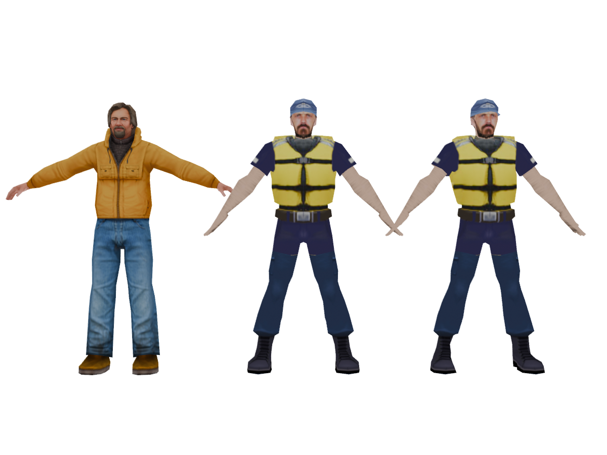

# Cut content

**In short:** *Jaws Unleashed* still contains a cut story stage (*Hot Pursuit*), a cut tutorial ending (the Aurora rope fight), a cut side challenge, an older Brody model, and many small leftovers. Some things that looked cut turned out to be in the game after all. This doc lists both.

Rewritten for readability on 2026-11-27. The previous version, with every dated correction, is in `docs/archive/cut_content_old_2026-11-27.md`.

---

## Contents

1. [Summary](#1-summary)
2. [Hot Pursuit: a cut story stage](#2-hot-pursuit-a-cut-story-stage)
3. [Cut tutorial ending: the Aurora rope fight](#3-cut-tutorial-ending-the-aurora-rope-fight)
4. [Old Brody model on the boss Aurora](#4-old-brody-model-on-the-boss-aurora)
5. [Other cut missions and stage slots](#5-other-cut-missions-and-stage-slots)
6. [Cut places and collectibles](#6-cut-places-and-collectibles)
7. [Small leftovers in the levels](#7-small-leftovers-in-the-levels)
8. [Dangling script references](#8-dangling-script-references)
9. [Not cut after all](#9-not-cut-after-all)
10. [*Sole Predator*: the working title](#10-sole-predator-the-working-title)

---

## 1. Summary

| What | Status | Section |
|---|---|---|
| *Hot Pursuit*, a jet-ski chase between stages 10 and 11 | Cut. Code complete; we made it playable. | §2 |
| Candy Wilson, Amity Police Chief | Cut. Text only. | §2 |
| Aurora rope fight at the end of the tutorial | Cut. Code complete; never placed. | §3 |
| An older Brody model and his animations | Leftover, partly visible | §4 |
| *Down the Hatch* side challenge | Cut. Code only. | §5 |
| Side challenges 26–32 | Removed | §5 |
| Highlands Bay | Cut. Name only. | §6 |
| Trident collectible | Never placed | §6 |
| Loose orca insides in AQUARIUM (PC) | Leftover | §7 |
| Static cage gate outside the orca arena | Leftover | §7 |
| Tiny rock `k2 03` in MINEMSHA | Leftover | §7 |
| Calmer alternate voice take in TOWN | Unused | §7 |
| 327 deleted objects still named in scripts | Leftovers | §8 |
| BEACH "submarine" and blocking boulders | **Not cut** | §9 |
| Dolphin Passage | **Not cut** | §9 |
| The Gauntlet mermaid | **Not cut** | §9 |

---

## 2. Hot Pursuit: a cut story stage

**In short:** a jet-ski chase that sat between stage 10 *Blood on the Beach* and stage 11 *The Final Chase*. Its mission code is complete in the PC game. Pieces of it are placed in two levels. We got it running as a custom level.

### What it was

- **Goal text:** *"Locate the jet skiers near the lighthouse and stop them from reaching the home of Amity Police Chief Candy Wilson."*
- **Failure text:** *"The jet skiers have escaped!"*
- **Boss phase:** *"Destroy all the jet skis!"*. Next to it sits a typo'd copy, *"Destroy all the jets kis!"*.
- The jet skiers flee to Candy Wilson's house for safety. The shark has to catch them first.
- **Candy Wilson is not the boss.** The boss is a list of tougher jet-ski riders (`m_JetSkiBossIDList`).

### Why it's a story stage, not a side challenge

- Its classes are named `StagePursuitQuest` / `StagePursuitQuest2`, like every real story mission (`Stage0Quest`, `StageBeachQuest`, …). Side challenges use other names (`…Mission`, `ANSideMission#`).
- The stage-name lists in both the PS2 and PC programs put "Hot Pursuit" between *Blood on the Beach* and *The Final Chase*.
- A developer level-select menu in `TITLE.GDW` lists it as **"10.Hot Pursuit"**. See below.

### How the mission code works

Fully compiled into `Jaws.exe`. Details: `docs/exe_analysis.md` "Cut story mission Hot Pursuit".

1. Jet skis race through a chain of gates. Each gate opens when a jet ski comes within 150 units and shuts behind it.
2. If the nearest jet ski gets farther than `m_PursuitLostDist` from the shark, you fail.
3. Once all gates are shut, an end-of-route event starts the boss fight.
4. Killing every jet ski and boss jet ski completes the mission.

`StagePursuitQuest` is an earlier draft: each kill opens the next gate and sends the survivors to another waypoint group. The "cheats" `OOOOOOZZZZZ` and `NNNNNNZZZZZ` are those waypoint-group letter sequences, not cheats.

### What's placed in the levels

**`MINEMSHA.GDW`** (Grand Occasus Canals):
- `JetskiChase`, `jetski 1`, `jetskipath` and `ccjetski`, all within ~3 units of `(-1254, 0, -787)`.
- They sit inside SC15 *Up a Creek*'s boat traffic, as a fourth entry beside the sailboats, rowboats and canoes.
- Their AI tuning is the same as the ordinary boats', so this was an early test step, not a finished chase.
- **In the shipped game a jet ski with a rider in A-pose spawns at this exact spot.**

**`OPEN_NE.GDW`:**
- A bare marker named `HOTPURSUIT` at `(612.5, 0, 3626.4)`, with no mesh.
- It is ~338 units from the `Brody's House` map marker, where no house was ever built. That fits a mission end point cut before its building was placed.
- Lighthouses: `Lighthouse02` is a bare placeholder ~4,270 units away. A fully modelled one (`vilagitotorony_*`) is ~5,900 units away, near the Coast Guard HQ.

The goal text (a lighthouse, open water, a house) fits `OPEN_NE` better than the canal. The canal may have been an early test bed. The final layout isn't known.

### The developer level-select menus in TITLE

`TITLE.GDW` holds five level-select menus as plain text. The PS2 `TITLE.GDE` has the same five.

| ID | Menu name | Entries |
|---|---|---|
| 1089 | `Level Select Action SCEE` | 1.The Arrival, 4.A Taste for Blood |
| 1090 | `Level Select Action Marketing Version` | 1.The Arrival, 2.Predator In The Bay, 3.The Angry Armada, 4.The Deep |
| 1091 | `Level Select Action` | 0.Open Ocean … 9.Blood On The Beach, **10.Hot Pursuit**, 11.The Final Chase, Open Ocean NE, Open Ocean NW, Fisherman, Minemsha, Gauntlet |
| 1092 | `Level Select Action Alpha` | 0.Open Ocean … 9.Blood On The Beach, 10.The Final Chase |
| 1093 | `Level Select Action - Pursuit` | The shipped names, including **The Facility** |

**What this shows:**
- **Hot Pursuit had its own level file, `PURSUIT`.** Its entry loads `GDLoad-Stage10 PURSUIT` (action 1204). Every other entry loads one of TITLE's built-in loading screens. No `PURSUIT.GDW` shipped.
- The numbered menus have no Facility entry, so *The Facility* became its own stage after they were written.
- "SCEE" (Sony Europe) and "Marketing Version" look like cut-down menus for demos or reviews.

**How the menus are stored:**
- Each menu is an `ACTN` block, class `0x0211D11C`.
- It holds up to 20 `[label][action ID]` pairs, in PROPs `0x08000B46`–`0x08000B69`.
- **The menu's name (`PROP 0x080017C3`) comes after its list.** In a strings dump, each list seems to belong to the next menu's name.

**Not known:** nothing references these menus, so we don't know if or how the shipped game can show them. Our custom level is also called `PURSUIT`, so action 1204 might load it through the mod. Untested.

### Playable restoration

```bash
python3 scripts/build_pursuit_test.py --deploy PURSUIT
```

Then press **F9** in-game and pick PURSUIT. This needs the mod; no stock file is changed. `--stock-jetski` builds an older, simpler version.

**What you get (version 10):**
- One jet ski with a rider races up the main canal on its own, on a reversed copy of the sailboats' route.
- Two pink gate walls vanish as it approaches (the gate opens) and come back 150 units after it passes (the gate shuts).
- Fall more than 700 units behind: *"The jet skiers have escaped! Mission failed!"*, and the stage restarts.
- Reach the yellow cube at the canal's north end after both gates shut: *"Destroy all the jet skis!"*
- Kill the jet ski to finish. The blue pillar near the start vanishes to show it.

**Known problems:**
- The route ends in the canal's north-west corner, so the jet ski drives into the bank.
- One jet ski only, and no boss jet skis.
- The gates are see-through markers, and no goal text is shown.
- In the boss phase, swimming far away despawns the jet ski, which counts as a kill.

How it was built (10 test builds): `docs/exe_analysis.md` "Running it in-game" and "Getting the jet ski to race".

### Evidence: the placed leftovers in detail

**Jet-ski nodes across the levels.** Names were checked through the name property, not raw strings.

| Node | Found in |
|---|---|
| `JetSki`, `Jetski_egyben` ("in one piece"), `JetskiGen`, `ANTargeting_jetski`, `JetskiOverlay*`, `JetskiQuickRef`/`MediumRef`/`SlowRef` | Many levels: the shared pool, so it means nothing |
| `jetski_mountpoint`, `jetski_mountpoint_a` | MINEMSHA, OPEN_S, TOWN |
| `jetskipath` | MINEMSHA, TOWN |
| `JetskiChase`, `ccjetski` | **Only MINEMSHA**: real placement |

**In MINEMSHA, the jet ski is part of *Up a Creek*'s boat traffic.**
- `JetskiChase`, `jetski 1` and `jetskipath` sit inside `SM16UpACreek`'s tree.
- They sit next to the shipped sailboats, rowboat and canoe. Each of those has a path (under `SM16ShipPaths`), a crew slot (under `SM16CrewContainer`) and a controller node (`cc…`).
- The jet ski uses the same three parts.

**`ccjetski`'s tuning is a copy of the civilian boats'.**
- It has ~24 number fields, PROP `0x08001036`–`0x0800104D`.
- Every meaningful value matches `ccvitorlasb`, `ccladik2` and `cccanoe`: speed 300 and thresholds 100/−5/30/200/100/50/50/100/1/50/1.
- Only two fields differ:
  - `0x08001038` is 27 for the jet ski and rowboat, 5 for the others. Probably a craft type.
  - `0x0800103A` is unset for the jet ski and sailboat, 21–22 for the others. Probably an unwired waypoint set.
- Nothing looks like chase or boss tuning.

**So the canal content was an early test step, not a nearly finished chase.** Someone copied a traffic entry for a jet ski, gave it a path and a rider, and stopped there. The rider stuck in A-pose fits: his animation was never hooked up.

**The `OPEN_NE` sites:**
- **`HOTPURSUIT`** has only the universal fields: name, transform and a zero-size box. It's a designer's position note, not a gameplay object.
- **Around it and the Brody's House marker**, within 400–500 units, are only canyon walls, a reused pair of rope-breaking rocks, and zone-wide markers: a buoy grid and 17 `TestPos` nodes. No foundations, no partial building.
- **`MapItem_Brody's House`** is one of ~50 automatic map-icon slots. Even the cut Highlands Bay has one.
- **In-game** (user): there's no house at the Brody's House spot, just open ground. A nearby "power station" turned out to be the separate Eastside Homes location.
- **Two lighthouses:**

  | Lighthouse | Position | What it is | Distance from `HOTPURSUIT` |
  |---|---|---|---|
  | `Lighthouse02` | — | A placeholder, near nothing named | ~4,270 |
  | `vilagitotorony_*` | (3581.2, 17.8, −1479.8) | Fully modelled from ~15 parts, by the Coast Guard HQ marker and a USA flag | ~5,900 |

  The user remembers the modelled one near the entrance to *Blood on the Beach*.
- **A possible reading:** the goal's "near the lighthouse" = the Coast Guard HQ lighthouse (the start), and "the home of Candy Wilson" = the empty Brody's House lot (the end). Unproven. Whether the canal content was a separate test or part of the same route is also unknown.

**Candy Wilson's house: the user's theory.**
- `Jaws.exe` has no "Candy's house" or "Wilson's house" string: only "BRODY'S HOUSE" in the normal map list, and the goal text.
- The user still thinks the lot was meant to be her house and was renamed early. A rename before the string table was built would leave no trace.
- Recorded as the user's working theory, not a finding.

**Which quest class uses the goal text?** It sits in a large shared pool of mission goals, next to unrelated stage 8 and 9 text. So reading the strings can't tell whether `StagePursuitQuest`, `StagePursuitQuest2` or both use it.

**Full text** (PC, in English, French, German, Italian and Spanish):
- *"Locate the jet skiers near the lighthouse and stop the jet skiers from reaching the home of Amity Police Chief Candy Wilson."*
- *"Kill all the jet skiers!"*
- *"Destroy all the jet skis!"*, and the typo copy *"Destroy all the jets kis!"*
- *"The jet skiers have escaped! Mission failed!"*

The PS2 program keeps only the short and failure lines. More: `docs/ps2_cut_content_findings.md`.

### Candy Wilson

- Amity Police Chief, named **only** in the Hot Pursuit goal text. It appears 5 times, once per language.
- No class, model or placement anywhere.
- The text is in the PC program only, but that doesn't date it. The PS2 program lacks the PC's whole mission-goal text, including shipped goals like "BEAT THE COLOSSAL SQUID BOSS!".
- "Brody's House" on the map is a real label for a real character. Only the house itself was never built.

---

## 3. Cut tutorial ending: the Aurora rope fight

**In short:** in the shipped tutorial (`START.GDW`, stage 1), Brody harpoons Jaws in a cutscene and the stage ends. Originally there was a **playable** part next: Jaws hooked to the Aurora by a line, pulling and snagging it on rocks to break free. The code is complete, the rocks and HUD pictures are placed, Brody's lines were recorded, but the rope itself was never placed.

The user has the rope-meter sprites and a beta screenshot showing it.

### What's left of it

- **The code** is in both the PC and PS2 programs: class `NAAuroraRope`, plus `NAAuroraRopeExcluder` for obstacles.
- **The tutorial prompt** (PC message 487): *"BREAK THE LINE BY TUGGING OR GETTING IT CAUGHT ON OBJECTS."* Never shown.
- **Four rope-breaking rocks** placed in PC `START.GDW` at the cutscene spot, with nothing referencing them:

  | Node | Name | Position |
  |---|---|---|
  | 2968 | `Kotelszakito_szikla_vf01` | (642, 19, −323) |
  | 2969 | `Kotelszakito_szikla_vf02` | (579, 19, −226) |
  | 2970 | `Kotelszakito_szikla_va01` | (640, −15, −327) |
  | 2971 | `Kotelszakito_szikla_va02` | (575, −15, −223) |

  *Kötélszakító szikla* = rope-breaking rock. `vf` / `va` probably mean above / below water, which matches their heights. The Aurora (`AURORA_LO0`) is at (606, 5, −250).
- **The rope-meter HUD sprites**, placed at the origin and unused: `Hooked_alap` (the meter base) and `Hooked_Kotel_0`–`_3` plus `Hooked_Kotel_4_Over` (the rope's damage stages, up to snapped). Nodes 2955–2960.
- **Brody's dialogue**, two never-played lines in START's `Movie` sound bank (samples 470/471, PC and PS2):
  - `VoiceBrody3`: *"Gottem! Hold tight, he's gonna try and break free!"* The start of the fight.
  - `VoiceBrody4`: *"Oh my God it's a Great White! Make sure he's fully restrained and let's get him to the research center ASAP."* The capture.
  - Transcribed by the user. Details: `docs/audio_leads.md`.

**The rope is never placed:** `NAAuroraRope` has 0 instances in all 20 PC and 22 PS2 levels. Neither does `MBAurora`, the Aurora as a drivable ship.

**On PS2** the tutorial is split into `START.GDE` and `START2.GDE`. The PC has no START2. `START2.GDE` holds the Aurora cutscene, the four rocks and the HUD sprites.

**It's not a Brody boss fight.** START's "Boss Meter 2" is the ordinary boat health bar. The real Aurora boss (`MSAuroraBoss`) is only in KATATAMA, stage 5.

### Winning the rope fight would have ended the tutorial

- The tutorial's stage brick, `MBStageTutorial`, finishes only when a game flag is set: `DDGameState.m_koteldied`, "the rope died" (`[0x8DA1C0]+0x12C`).
- Only `NAAuroraRope` sets that flag. So breaking the rope was meant to end the stage.
- In the shipped game this path is dead. The stage ends through `NATutorialQuest`'s Aurora movie instead.
- `MBStageTutorial` also starts in state 4, skipping states 0–3, which would have triggered the Zodiac boats once boat damage reached 1,000. See `docs/speedrun_glitches.md` section 7.

### How the rope fight worked

Read from the decompiled game code (2026-11-02). It wasn't run.

**In plain words:**
- Brody keeps reeling Jaws in.
- Pulling away hard stretches the line. That frays it, but it also makes Brody let out line, drags the Aurora along, and hurts the shark.
- Dragging the line across the rocks snags it and takes a chunk of its strength each time.
- If the line breaks, the tutorial ends.
- If Brody reels Jaws all the way in and holds him for 2 seconds, `m_finalmovie` plays. That is probably the capture, which the shipped game shows as a plain cutscene; stage 2 starts with Jaws captured.
- Whether being caught counted as losing, or as a second way to finish, isn't clear.

**Each game tick, step by step:**
1. **Rope length.** The rope has a current length `L`, spread over its segments.
2. **Brody reels in.** If the shark hasn't pulled for `m_nemhuztime` ticks, `L` shrinks by `m_behuz`, down to `m_minlen`.
3. **Caught.** If `L` stays at `m_minlen` for 60 ticks (2 s), `m_finalmovie` starts and the rope is removed.
4. **Tension.** Stretch `r` = actual length ÷ `L`. Above `m_treshold`, tension `t = 1 − m_halfdist / (m_halfdist + r − m_treshold)`, which runs from 0 to 1. Then:
   - the rope loses `m_feszulhpszorzo × t` strength every tick;
   - if `t ≥ m_belsofeszulkotelkifele`, Brody lets out line: `L` grows by `m_kienged × t`, up to `m_maxlen`;
   - if `t > m_hajothuzfesz`, the shark tows the Aurora;
   - the rope hurts the shark: `m_kotelsebez` damage under high tension, or `m_kozelvansebez` when too close to the boat. It also pulls the shark by `m_kotelforce`.
5. **Broken.** When the rope's strength reaches 0, it sets `m_koteldied`, and the tutorial ends.
6. The rope's first segment is pinned to the shark's mouth.

**Snagging.** `NAAuroraRopeExcluder` is an obstacle the line can't pass through. It can be:
- a sphere;
- a column;
- a model's collision shape.

On contact it damages the rope by `m_damage`, plays an effect, and can leave an anchor that keeps the line caught. The damage is applied at most once every `m_damagetime` ticks, with a pad rumble. **The four rocks were meant to carry these.**

**The Aurora wears the line too:** when the ship hits something, it damages the rope by `m_hajotolkotelserul`.

**The HUD:**
- The shark and ship icons slide toward each other as the line is reeled in.
- The rope picture shows its damage stage: `(max − current strength) × 4 / max` picks `Hooked_Kotel_0` to `_4_Over`.
- It flashes with tension.

**A shipped cousin:** `MBShipRope`, placed once in `OPEN_S`, is a stripped-down copy. It has the same tension, towing and damage, but no strength, reeling, HUD or movie.

### Making it playable

It would need, in START:
1. an `NAAuroraRope` brick, plus the fields of its `NARope` base class;
2. an `MBAurora` on the Aurora;
3. excluders on the four rocks;
4. the `Hooked_*` sprites wired to the HUD fields;
5. a movie for `m_finalmovie`.

All the classes are compiled in. The next step is decoding `NARope`'s fields and finding a shipped level that places one, to copy from.

### Evidence: classes and addresses

| Class | What it is | Addresses in `Jaws.exe` |
|---|---|---|
| `NAAuroraRope` | The line. A subclass of the engine's rope `NARope` (constructor `0x5AA3F0`, physics `0x5ABAE0`). | descriptor `0x8DB828`, vtable `0x7DA4D4`, tick `0x4BC670`, activate `0x4BC470`, deactivate `0x4BD010`, damage `0x4BD100`, message hook `0x4BBD90` |
| `NAAuroraRopeExcluder` | An obstacle that snags the line | descriptor `0x8DC8E0`, vtable `0x7DA5E8`, tick `0x4BD780` |
| `MBAurora` | The Aurora as a drivable ship | descriptor `0x8DCD00`, collision handler `0x4B9610` |
| `NAAuroraRopeBuoyRopeInteractor` | An action; not decoded | vtable `0x7E69CC`, tick `0x574DC0` |
| `MBShipRope` | The shipped cut-down rope | descriptor `0x8DBD48` |

**Other details:**
- `NAAuroraRope` has 37 tuning fields, listed by `scripts/dump_class_fields.py`.
- The Hungarian field names: *kötél* = rope, *hajó* = ship, *cápa* = shark, *kienged* = let out, *behúz* = reel in.
- Debug text: `Kienged, feszul:%f`, `Behuz`, `Kotel len:%f`.
- Rope messages: `0x29A` (snag damage) and `0x41` (hurt and pull the shark).
- `m_koteldied` is written at `0x4BC8E3`, `0x4BCE98` and `0x4BD19A`.

More: `docs/exe_analysis.md` "Cut Aurora rope".

### Open

- The `Kotelszakito_szikla` names also occur in FISH and the three open-ocean levels. Are they placed there, or only in the shared pool? Unchecked.

---

## 4. Old Brody model on the boss Aurora



**In short:** the Brody standing on the Aurora in the stage 5 boss fight (KATATAMA) is an **older character model**. A hidden twin in OPEN_NE still carries his old animations, including a throat-slit gesture. They come from an earlier version of the tutorial's ending.

### The two models

| | Old Brody | Shipped Brody |
|---|---|---|
| Look | Younger, dark curly hair, beard, blue cap, yellow life vest, navy cargo trousers, boots | Older, grey hair, yellow jacket, jeans |
| Bones | 56 | 24 or 30 |
| Vertices | 1,398 | 822 |
| Textures | 11 small ones (64×64 or 64×128) | One 256×256 |
| Where | KATATAMA boss Aurora; hidden in OPEN_NE | AQUARIUM, START, KATATAMA, DEEPSEA2, TOWN, BEACH |

### The KATATAMA copy (visible)

- Node `Brody` (3721), on the boss Aurora's deck. He rides along with the boat in the boss cutscene and the fight.
- Position on the boat: local offset (0.03, 10.6, −1.35); world (324, 11, −1146). He's 2.08 units tall, normal human size.
- Model: `SKEL 2317`, `GMDL 2803`.
- Node chain: under `BrodyHelye` (3720, "Brody's spot"), under `AuroraBrick` (3665, the `MSAuroraBoss` brick).
- Nothing scripts him.
- He uses the generic animator `GDSkeletonAnim`, not the `NASkeletonAnim` that cutscene Brodys use.
- His skeleton holds a 30-frame loop, the length of the steering clip, so he stands at the wheel.

### The OPEN_NE twin (hidden)

- Node `CoastGuard 1` (4662): same model, same textures under different IDs. `SKEL 2454`, `GMDL 2861`.
- It hangs from the helicopter's rope ladder in SC06 *Flip the Bird*'s intro, but it is set "not rendered" and nothing shows it. **It never appears.**
- Despite the node name, it is the old Brody (user-confirmed). All its clips are named `MBrody_*`.

**Its animation clips:**

| Clip | Frames |
|---|---|
| `MBrody_AuroraComesMovie` | 265 |
| `MBrody_AuroraCatchesMovie` | 90 |
| `MBrody_GrabHarpoonMovie` | 36 |
| `MBrody_Kormanyoz` (steering) | 30 |
| `MBrody_EscapeAtL4` | 1 |

**A matching shark clip:** TITLE's menu shark (`GWside 1`, `SKEL 845`) carries an unused 90-frame clip, `Shark_GW_Movie_L2_AuroraCatches`. That's the same length as Brody's `AuroraCatches`. The name exists only in `TITLE.GDW`.

### The throat-slit gesture

Spotted by the user. In `MBrody_AuroraComesMovie`, Brody:
- stands still until about frame 90;
- raises his right arm high (≈100–125);
- points to the side (≈135–160);
- lowers it;
- from about frame 215, draws his hand across his throat.

Pictures: `docs/images/old_brody_auroracomes_f140-230.png`.

The shipped tutorial ending fills the same 265 frames with entirely different motion: Brody shades his eyes, leans, stumbles, then puts both hands on his head (`docs/images/old_vs_shipped_brody_265f.png`). **So it's a new animation, not a retarget.** The matching length suggests the same cutscene slot was reanimated.

A hostile hunter Brody was replaced by a frightened one. But the scene still ended in a capture: the partner clip is "AuroraCatches", and the unused voice line says to take the shark "to the research center".

### Where the old clips belong

The old clip names describe the shipped tutorial ending. In `START.GDW` that ending is the group `AuroraComesMovie` (198). It contains the Aurora, two crew, a helmsman at the wheel playing the clip `Kormanyoz`, the harpoon line, the new Brody, the shark and a victim.

| Old Brody clip | Shipped ending |
|---|---|
| `AuroraComesMovie` | The Aurora arrives |
| `Kormanyoz` | A generic helmsman now stands at the wheel |
| `GrabHarpoonMovie` | Brody fires the harpoon |
| `AuroraCatchesMovie` (+ the shark's clip) | The capture |

**Reading (inference):** an older cutscene set for this ending had old Brody at the wheel, grabbing the harpoon and catching the shark. "L2" and "L4" in the clip names don't match the shipped stage order, so the stage list was different then. "EscapeAtL4" may be Brody's helicopter escape, which the shipped game has in stage 5.

### Blender scene

`animations/OldBrody_AuroraCatches_scene.blend` puts the old Brody, with all five clips, on the boss Aurora's deck, next to the TITLE shark playing its `AuroraCatches` clip.
- Frames 1–90, at 30 fps.
- **The shark's position is a guess.** No data gives where it should be.
- Each rig hangs from an Empty (`Brody_on_deck`, `Shark_by_eye`); move the Empty to reposition it.
- Change Brody's clip in the Action Editor.

Pictures: `docs/images/old_brody_vs_shipped.png`. The raw textures (`docs/images/old_brody_textures.png`) stay local, not in the repo.

### Open

- Compare the model with the user's beta screenshots and the trailer.
- Is the boss Aurora's Brody visible from normal play distance?

---

## 5. Other cut missions and stage slots

### *Down the Hatch* (cut side challenge)

- Class `MSHatchMission`. The stage list text reads `"Down the Hatch (unused!)"`.
- Goal: `SWALLOW %d COLLECTABLES WITHIN %d SECONDS.`
- Three difficulties (`m_EasyNum`, `m_MediumNum`, `m_HardNum`), each with a time limit.
- A simpler version of SC22 *The Gauntlet*, which has you collect tyres.
- Never placed in any level.

### Side challenges 26–32 were removed

The five `ANSideMission` classes map to the displayed challenge numbers like this:

| Class | Shown as |
|---|---|
| 15 | SC14 |
| 21 | SC20 |
| 22 | SC21 |
| 25 | SC24 |
| 33 | SC29 |

- The first four are off by one. Class 33 is off by four.
- So classes 26–32 existed and were removed: **at least 3 cut side challenges**.
- *Down the Hatch* may have been one of them.
- Full table: `docs/mission_system.md`.

### 18 stage slots, 11 used

- The stage-select object `MSStageSelect` has 18 slots (`m_Stage1ID`–`m_Stage18ID`). The game has 11 story stages.
- Story-quest classes without a shipped stage: `StagePursuitQuest`/`2` (§2) and `StageDocksQuest`.

**The user's theory:** exactly 7 side challenges have opening cutscenes. Do they reuse content from 7 cut story stages?
- The 7 are SC01 *Barrels of Fun*, SC02 *Seal Whip*, SC03 *Bay Patrol Blood Bath*, SC06 *Flip the Bird*, SC07 *Reality TV*, SC12 *Trouble and Strife* and SC19 *Get Mr. Stripes*. Confirmed.
- Two of them live inside story levels instead of the shared open ocean: *Trouble and Strife* in START, *Get Mr. Stripes* in WRACK.
- **No proof of reuse found.** Neither class has leftover story-quest fields.
- The settled answer would be the values in `MSStageSelect`'s 18 slots, but its real instance hasn't been found. It's probably in `TITLE.GDW`'s `SCRT` tree.
- Details: `docs/mission_system.md` "Side challenges with opening cutscenes".

---

## 6. Cut places and collectibles

### Highlands Bay (cut)

- It is in the map-name list, between ENVIRONPLUS MINING SITE and BRIDGEPORT SOUND, and gets a map icon slot like every location.
- **It has no real map position** (`MapItemPos_Highlands Bay`) in any of the three open-ocean levels. It was never placed.

### The Trident (never placed)

- The collectible catalogue has 13 categories. Categories 01–08 use `CGO_` names. The others use three more naming styles: `BSCollectibleGameObject <Name>`, `<Name>Collectibles`, and bare names.
- **Only the Trident (category 10) is placed nowhere**, under any naming style.
- Its model exists: `TridentStaff` in `WRACK.GDW`, 208 triangles.

Where the rarer ones are:

| Collectible | Level |
|---|---|
| Pirate Ship | DOCKS |
| Body Bag | START, TOWN |
| Mermaid | KATATAMA, GAUNTLET |
| Nautilus | AQUARIUM |
| Diamond Necklace | WRACK. Verified in-game by scaling it up 10×. |

The first check missed these by searching for one naming style only; the user caught it. Full table: `docs/mission_system.md`.

---

## 7. Small leftovers in the levels

### Loose orca insides in AQUARIUM (PC only)

Found by the user.
- The bleeding "insides" mesh you see when biting the boss orca (`GMDL 2647`) is placed three times in PC `AQUARIUM.GDW`:
  - `Boss_Orca_Inside01` (27744), attached to the orca. The real one.
  - **`Boss_Orca_Inside01 2`** (2804) at about (−267, −1.0, 98).
  - **`Boss_Orca_Inside01 3`** (2806) at about (−61, −1.5, −121).
- The last two float at the water surface, attached to nothing, so they show as loose carcasses. The user found both in-game.
- **PS2:** the aquarium is split into `AQUARIUM.GDE` and `AQUA2.GDE`. Only `AQUA2` has the name, once, which fits only the boss's own copy. The PS2 name table is shared, so this isn't certain.
- Probably leftover test copies, cleaned out of the PS2 build but not the PC one.

### A static cage gate outside the orca arena (AQUARIUM)

Found by the user.
- `Ketrec_Ajto01` ("cage door", node 7430) stands just out of bounds of the boss-orca arena, at about (933, −193.5, −156.5).
- It has no collision, no logic and no script.
- It's the same model as the breakable cage gates, with the scaling built into the mesh.
- Its twin `Ketrec_Ajto04` (7427) sits exactly where breakable gate 6 is, and is switched off.
- No breakable gate exists at `Ketrec_Ajto01`'s spot. The nearest is ~80 units away.
- **Reading:** two static gates from before the breakable-gate setup. One was switched off when gate 6 replaced it. The other was left on, at a spot from an older arena layout.

### A tiny stray rock in MINEMSHA

Found by the user.
- `k2 03` (node 3030) at (−1401, −21, −842), outside the playable canals. No collision, and nothing refers to it.
- It's the open-ocean seabed rock `k2 1`, shrunk to 0.34 scale, about 1 unit wide. In the open ocean the same rock is used at scale 3–6.3.
- It sits among edge-filler pieces (`inter03`, `takar05`), and its ID follows `takar05`. The PS2 file has it too.
- **Reading:** copied in by mistake while the edge pieces were placed, and never cleaned up. `k` may be Hungarian *kő*, "stone".

### A calmer alternate voice take (TOWN)

- TOWN sample **388** (`MovieTown1.VoiceCrew2`, 6.18 s): *"Something's happening out at the pond. Mr. Mayor, we must leave! Things are getting... Oh shit, look at the size of that thing!"*
- Recorded by a **different voice actor in a calmer tone** than the shipped take 387. Identified by the user, by listening.
- It's in the sound banks, but nothing plays it. It's the only unused one of the 49 captioned cutscene lines.
- See `docs/cutscene_dialogue.md`.

---

## 8. Dangling script references

**In short:** the level scripts (`GDControl`) still name **327 objects that were deleted** during development. They show what used to be there.

- All the missing IDs are below their level's highest ID, so they were deleted, not created at runtime.
- 10 of the controls are shared prefabs, found in 8 or more levels: menus, the shark's pause and caught overlays, the loading effect, and the shooting control.
- 146 are level-specific. Most are routine, such as clean-up of removed effects.
- See them with `scripts/dump_gdcontrol.py`. Missing targets show as `missing#<id>`.

**The notable ones:**

| Level | Control | What it shows |
|---|---|---|
| WRACK | `MayorFeliratKiBeKapcsolgato` ("mayor caption on/off") | Turns two deleted objects on and off during the mayor's interview: old caption overlays, replaced by captions built into the sounds. This lead found the cutscene voice acting. |
| AQUARIUM | `SeahorseBizgeto` ("seahorse jiggler"), `EndOfScene2` | Pauses 9 deleted objects during exhibition-hall scene 2: probably a removed seahorse display |
| AQUARIUM | `cinema203_starter`, `movie4-snitt1-start`, `return to game 1` | Missing IDs spaced 8 apart between the surviving seals: several seals removed from the seal pool |
| TOWN | `firework 1`, `firework 2` | Each fires 7 bursts from 7 emitters, but only 2 emitters survive. The fireworks show was cut down. Same on PS2. |
| TOWN | `NaEzekreNincsSzukseg` ("we don't need these") | Hides vehicle HUD overlays, plus one deleted overlay |
| OPEN_NE / NW / S | per-destination controls (`BeachControl`, `DoxControl`, …) | Each adds a "white triangle" map marker. In OPEN_NE only the Armada and Town markers survive. |
| DEEPSEA | `grinderkikapcsolo` ("grinder switch-off") | Part of the grinder machinery was removed |
| DEEPSEA | `room1pusztulas`–`room4pusztulas` ("room N destruction") | Each starts a deleted object, just before its room's control group |
| START | `SzetfroccsenoDarabokController3` (Shaw's death movie) | Adds blood-splash pieces that no longer exist |
| TITLE | `Mpeg Demo 1 Control …` | The attract-mode demo loaders point at deleted objects |

---

## 9. Not cut after all

### The BEACH "submarine" and blocking boulders

**In short:** it looked like a cut "destroy the sub, blast the boulders, reach a new area" objective. **It isn't.** The "sub" is an ordinary SeaSeeker set up to stand still, and the boulders seal off an unfinished edge of the map.

**What the user noticed:** in BEACH and BEACHPST, a "drone" sits motionless under the bridge and drains your hunger. Not far away, a named group of three rocks (`Level3_elzarokovek`, "blocking rocks") seals a canyon. START has a working version of the same idea: destroy a SeaSeeker, a boulder blows up and the path opens.

**What the data says:**
- **The "drone" is a SeaSeeker**, `ANSeekerRef 4` (BEACH node 1915) at (−233, −17, 265). The tutorial hint describes these: *"The seaseeker on the ocean floor is making you hungry. Destroy it…"*
- **It was set up to stand still on purpose.** It inherits the hunger drain like the others:

  | Field | Seeker 4 (bridge) | Seekers 1–3 |
  |---|---|---|
  | `m_chase_shark` | off | on |
  | `m_lookdistance` | inherited | 180 |
  | `m_alarmdistance` | inherited | 40 |
  | `m_chasearea` | none | a patrol area |
  | `m_lights` | off | on |

- **Nothing links it to the rocks.** None of BEACH's 1,112 script blocks (836 in BEACHPST) mentions the rocks, the invisible barrier plate or any SeaSeeker. No property does either, and the game program doesn't contain their names.
- **START's working version is wired up.**
  - Its SeaSeeker has two mission objectives as child nodes.
  - Its boulder has its own controller and a dust effect.
  - Checkpoint clean-up scripts remove the boulder.
  - It is on the quest manager's list.
- **BEACH's rocks are plain scenery.** They use the level's most common render settings and have no effect, controller or reference.
- **Behind the rocks** is a short walled channel ending at beach sand. No markers, triggers or exits.

**In-game test (user):**
- The rocks were moved 50,000 units down. The canyon behind is an empty stub: the seafloor stops after a short way.
- Killing the bridge seeker triggers nothing.
- The seeker layout matches the data:
  - BEACH: 3 working seekers, plus the still one under the bridge, ~135 units from the rocks.
  - BEACHPST: 2 seekers, the ditch one and the bridge one.

**What's left** is only circumstantial: the "blocking rocks" name, a short walled channel heading inland, and a stream painted on the world map. At most the designers once planned to extend the area.

**The first theory was wrong.** It was written July–August 2026, before the tools existed to check it. It said:
- the drone was a `TKSub` mini-submarine class;
- the rocks hid a large built area;
- BEACHPST not having the rocks cleared meant the objective was never finished.

The wording is in the archived version of this doc.

#### Evidence: the `ANSeekerRef` fields

- 74 fields; **PROP ID = `0x080002E9` + field index**, in registration order.
- On reference nodes, 0 means "use the template's value".
- Yes/no fields have three values: 0 = inherit, 1 = off, 2 = on.
- PROP IDs of the fields above:

  | Field | PROP |
  |---|---|
  | `m_chase_shark` | `0x080002F1` |
  | `m_lookdistance` | `0x08000308` |
  | `m_alarmdistance` | `0x08000309` |
  | `m_chasearea` | `0x08000310` |
  | `m_lights` | `0x08000312` |

- All BEACH SeaSeekers are reference copies of the template `ss_mobile` (BEACH node 19822, class `ANSeeker`).

#### Evidence: START's boulder vs BEACH's rocks

| | START `TunnelBlockingDust` (2083) | BEACH `Level3_elzarokovek` (4882; BEACHPST 4559) |
|---|---|---|
| Structure | One rock | A group of 3 rocks, `Elzaroko01`–`03` |
| Mesh | GMDL 3234, about 13 × 26 × 39 | GMDL 2557 (BEACHPST 2506), about 17 per side |
| Texture | Dark grey cliff rock | Mossy green seabed rock |
| Collision | MREG 3925 | MREG 3044 (BEACHPST 2978) |
| Flags | `0x4A` (local transform) | `0x2000005A` (absolute) |
| `m_Viewport` | `0x80002` | `0xE0003` |
| `m_RenderSetting` | `0x280820` | `0x820` (the level's most common value) |
| Dust effect | Yes (`TunnelBlockingRockDust`) | No |
| Extra barrier | None | Invisible plate `Kizaro_Lap_Kozepes 7`/`8` |
| Own controller | `SeaSeekerQuestEventControl` | None |
| Referenced by | Two checkpoint clean-ups, `SideMissionControl`, the quest manager | Nothing |
| Linked SeaSeeker | `LastSeaSeekerRef`, with objectives 13 and 14 | None |

### Dolphin Passage

- First flagged as cut because no mission uses it.
- **It's real.** It's the water channel between Open Ocean South and Open Ocean East. The user swam through it.
- Its map position `(4693.3, 0, -2267.0)` is the same in both `OPEN_S` and `OPEN_NE`, next to each zone's transition marker (`FromS`, `FromNE`).

### The Gauntlet mermaid

- Collectible 12 is a static statue in KATATAMA.
- In SC22 *The Gauntlet* it's a live, swimming mermaid that you collect by biting: `MermaidModel 1`, `SKEL 946`.
- Appaloosa's 2001 Mermaid tech demo is a different character.
- Details: `docs/mission_system.md`, and `docs/ecco_leftovers.md` "Appaloosa Mermaid tech demo".

---

## 10. *Sole Predator*: the working title

- The game was developed at Appaloosa (formerly Novotrade, Budapest) as ***Sole Predator***, before Majesco licensed *Jaws*.
- The name survives only in a few promotional textures that describe the game's features.
- It's absent from mission, class and mode names and from script text. The rename was applied to the code and data but not to every texture.
